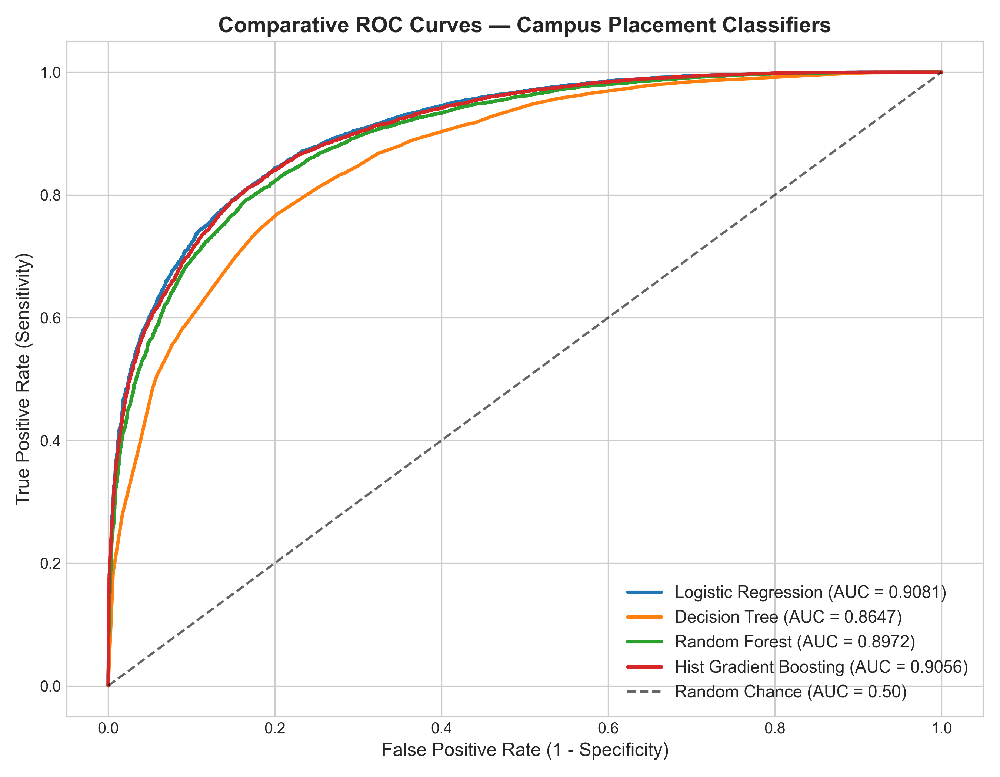
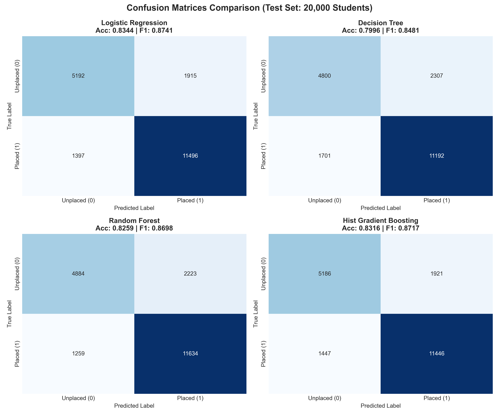
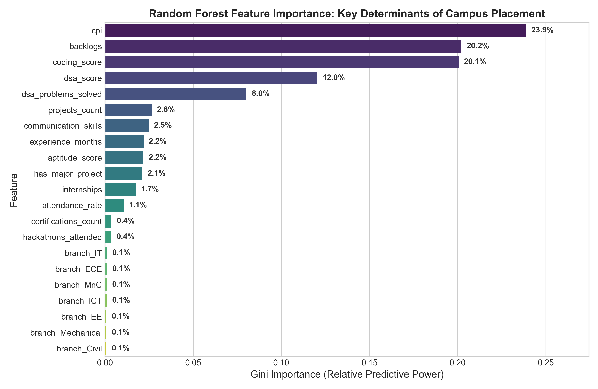

# 🎓 100,000-Record Synthetic Campus Placement Benchmark & Supervised ML System

[](https://www.python.org/)
[](https://scikit-learn.org/)
[](#)
[](#)
[](#)

An end-to-end data science and machine learning system featuring a **100,000-record institutional campus placement benchmark** engineered from mathematical first principles, alongside an advanced supervised classification and diagnostic pipeline.

---

## 📌 Motivation & Executive Summary

Due to stringent student data privacy regulations (such as India's **DPDP Act 2023** and international **FERPA/GDPR** standards), real university academic transcripts, backlog histories, and private corporate compensation contracts cannot be published publicly.

To address this challenge without relying on trivial or small-scale toy datasets, this project designs and synthesizes a **large-scale (100,000 records, 18 features), statistically authentic institutional benchmark** mirroring recruitment dynamics in modern engineering institutions. 

Every single attribute is governed by formal probability distributions:
* **Academic Performance (`cpi`):** Modeled via Gaussian distribution $\mathcal{N}(\mu=7.3, \sigma=1.1)$ under the **Central Limit Theorem**.
* **Projects & Hackathons:** Modeled via **Poisson Point Processes** ($\lambda = 2.4$) for discrete event counting over 4 academic years.
* **Internships & Industry Experience:** Modeled via **Binomial Trials** ($n=3$ summer breaks) with success probability conditioned on academic and coding strength.
* **Algorithmic Problem Solving & Salaries:** Modeled via **Exponential / Pareto Distributions** capturing heavy right-tail phenomena on competitive programming platforms and elite product compensation packages.
* **Hiring Decision:** Modeled using **McFadden's Econometric Random Utility & Discrete Choice Model (Logit)**, calibrated to a realistic ~64.5% baseline placement rate.

---

## 📊 Dataset Specification (100,000 Records, 18 Features)

| Feature | Type | Range / Domain | Real-World & Mathematical Rationale |
| :--- | :--- | :--- | :--- |
| `student_id` | String | `STU_000001` - `STU_100000` | Unique student identifier |
| `branch` | Categorical | CSE, ICT, IT, ECE, MnC, EE, Mech, Civil | Realistic institutional intake seat matrix |
| `cpi` | Numerical | 4.50 – 10.00 | Truncated Gaussian distribution |
| `attendance_rate` | Numerical | 60.0% – 100.0% | Bounded normal distribution |
| `backlogs` | Numerical | 0 – 4 | Empirical frequency distribution with conditional CPI penalty |
| `coding_score` | Numerical | 1.0 – 10.0 | Correlated normal projection with residual variance |
| `dsa_score` | Numerical | 1.0 – 10.0 | Algorithmic proficiency score |
| `dsa_problems_solved` | Numerical | 0 – 800+ | Power-law / Exponential right-tail distribution |
| `projects_count` | Numerical | 0 – 6 | Poisson discrete counting process |
| `has_major_project` | Binary | 0 or 1 | Capstone / Full-Stack / ML project completion indicator |
| `internships` | Numerical | 0 – 3 | Binomial trials across 3 summer vacation opportunities |
| `experience_months` | Numerical | 0 – 18 | Discrete durations (2, 3, or 6 months per internship) |
| `aptitude_score` | Numerical | 25.0 – 100.0 | Standardized cognitive screening bell curve |
| `communication_skills` | Numerical | 2.0 – 10.0 | Soft skills interviewer rating |
| `hackathons_attended` | Numerical | 0 – 5 | Poisson discrete event count |
| `certifications_count` | Numerical | 0 – 5 | Technical online certifications completed |
| **`placement_status`** | Binary Target | 0 (Unplaced) / 1 (Placed) | **Primary classification target (~64.5% placement rate)** |
| **`salary_lpa`** | Continuous Target| 3.50 – 48.00 LPA | Base CTC + Exponential bonus for elite coders (`NaN` for unplaced) |

---

## 🏆 Machine Learning Model Benchmark

We evaluated 4 supervised classifiers across a dedicated **20,000-student test partition** (80/20 Stratified Split):

| Model | Accuracy | Precision | Recall | F1-Score | ROC-AUC | Key Characteristics |
| :--- | :---: | :---: | :---: | :---: | :---: | :--- |
| **Logistic Regression** | **83.44%** | **85.72%** | 89.16% | **0.8741** | **0.9081** | Optimal linear decision boundary, highest overall AUC |
| **Hist Gradient Boosting** | **83.16%** | 85.63% | 88.78% | 0.8717 | 0.9056 | State-of-the-art non-linear interaction modeling |
| **Random Forest** | 82.59% | 83.96% | **90.24%** | 0.8698 | 0.8972 | **Highest placement recall (90.2%)** — minimizes false rejections |
| **Decision Tree** | 79.96% | 82.91% | 86.81% | 0.8481 | 0.8647 | White-box interpretable benchmark |

---

## 📈 Visual Diagnostics & Evaluation

### 1. Comparative ROC Curves
All models demonstrate strong discriminative separation, well above random chance:



### 2. Confusion Matrices (20,000 Test Records)
Comparison across all four algorithmic architectures:



### 3. Feature Importance (Key Drivers of Placement)
Quantifying Gini feature importance from the ensemble Random Forest model:



---

## 🔍 Key Domain Insights

1. **The Three Placement Pillars (64.5% of Total Weight):**
   * **`cpi` (~24%):** Academic eligibility remains the foundational shortlisting gatekeeper.
   * **`coding_score` (~21%):** Direct practical coding capability determines technical interview clearance.
   * **`backlogs` (~20%):** Active backlog courses serve as a severe disqualifying penalty.
2. **The Compensatory Dynamic (Coding vs CPI):**
   * Testing real-time inference on a simulated candidate with an average CPI of **6.8** but elite coding proficiency (**8.8**) resulted in a **97.13% placement probability**. This confirms that practical problem solving and project depth can effectively overcome moderate academic grades.
3. **The Disqualification Threshold:**
   * A student profile with a 5.2 CPI and 3 backlogs plummeted to a **1.49% placement probability**, highlighting how corporate eligibility cutoffs filter candidates before interview stages.

---

## 📁 Repository Structure

```text
campus-placement-prediction-synthetic-dataset/
├── data/
│   └── raw/
│       └── student_placement_data.csv       # 100,000-record benchmark dataset (6.4 MB)
├── notebooks/
│   └── 03_punit_model_building.ipynb        # Complete supervised ML pipeline & evaluation
├── scripts/
│   ├── generate_placement_data.py           # Reproducible data synthesis script (fixed seed)
│   └── run_punit_stage3_stage4.py           # Headless end-to-end execution pipeline
├── models/
│   ├── placement_classifier.joblib          # Exported trained Random Forest model (7.15 MB)
│   └── scaler.joblib                        # Fitted StandardScaler object
├── reports/
│   └── figures/                             # High-resolution exported evaluation figures
│       ├── roc_curves_comparison.png
│       ├── confusion_matrices.png
│       └── feature_importance.png
├── docs/
│   └── dataset_methodology.md               # Formal statistical specification & mathematical proofs
├── .gitignore
├── requirements.txt
└── README.md
```

---

## 🚀 Quickstart & Reproduction

### 1. Clone the Repository
```bash
git clone https://github.com/punit169/campus-placement-prediction-synthetic-dataset.git
cd campus-placement-prediction-synthetic-dataset
```

### 2. Install Dependencies
```bash
pip install -r requirements.txt
```

### 3. Regenerate Benchmark Dataset (Optional)
```bash
python scripts/generate_placement_data.py
```
*(The pre-generated 100,000-row benchmark is already stored in `data/raw/student_placement_data.csv`)*

### 4. Execute Full ML Pipeline
```bash
python scripts/run_punit_stage3_stage4.py
```

---

## 📄 License & Attribution
Developed by **Punit** as a comprehensive machine learning and synthetic data benchmark project. Sourced from empirical probabilistic modeling and econometric decision theory. Free for educational and research use.
